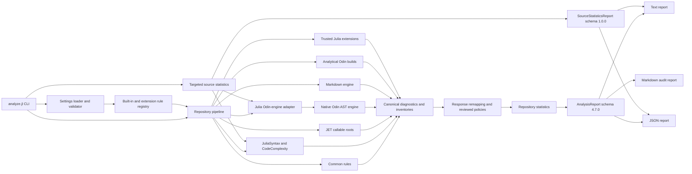
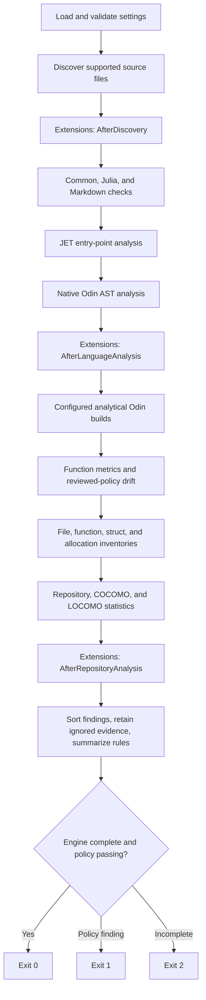
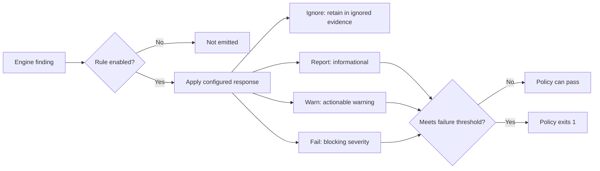
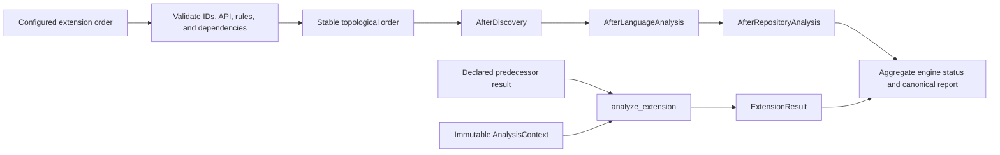

# Odin/Julia Analysis

Static analysis and policy enforcement for codebases that combine Odin, Julia,
supporting SQL and HLSL sources, and Markdown documentation.

`OdinJuliaAnalysis` provides one repository-level view across both programming languages:
parser-backed source checks, function metrics, JET inference, analytical Odin builds,
allocation evidence, policy exceptions with drift detection, repository statistics, and
project-specific trusted extensions. Configured LCOV tracefiles can be correlated with
static test reachability without making the analyzer responsible for running tests.

## Table of Contents

- [At a Glance](#at-a-glance)
- [Requirements](#requirements)
- [Quick Start](#quick-start)
- [Command-Line Interface](#command-line-interface)
- [Architecture](#architecture)
  - [Component Map](#component-map)
  - [Analysis Pipeline](#analysis-pipeline)
  - [Project Layout](#project-layout)
- [Analysis Capabilities](#analysis-capabilities)
  - [Rule Families](#rule-families)
  - [HLSL Lexical Accounting](#hlsl-lexical-accounting)
  - [Repository Statistics](#repository-statistics)
  - [Targeted Source Statistics](#targeted-source-statistics)
  - [Analytical Odin Builds](#analytical-odin-builds)
  - [Test Coverage Evidence](#test-coverage-evidence)
- [Configuration](#configuration)
  - [Settings Model](#settings-model)
  - [Responses and Exit Behavior](#responses-and-exit-behavior)
  - [Profiles and Exclusions](#profiles-and-exclusions)
  - [JET Entry Points](#jet-entry-points)
  - [Reviewed Policies](#reviewed-policies)
- [Trusted Extensions](#trusted-extensions)
  - [Extension Contract](#extension-contract)
  - [Lifecycle and Dependencies](#lifecycle-and-dependencies)
  - [Result Contract](#result-contract)
- [Reports and Artifacts](#reports-and-artifacts)
- [Using the Sample](#using-the-sample)
- [Testing the Analyzer](#testing-the-analyzer)
- [Integration Guide](#integration-guide)
- [Troubleshooting](#troubleshooting)
- [License](#license)

## At a Glance

| Capability | Implementation | Result |
| --- | --- | --- |
| Julia analysis | JuliaSyntax, CodeComplexity, and JET | Syntax, declarations, metrics, naming, and inference findings |
| Odin analysis | Native Odin AST helper | Syntax, declarations, metrics, naming, and allocation evidence |
| Markdown analysis | MarkdownAST-backed Julia engine | Structure, links, and image accessibility policy |
| SQLite analysis | Standalone Julia lexer and structural parser | Statements, query/declaration interfaces, six configurable conventions, explicit capability gaps |
| HLSL accounting | Standalone Julia lexical scanner | Source line totals and common formatting checks; no syntax or structural analysis |
| Cross-language policy | Canonical repository model and extensions | One rule registry, response model, report, and exit code |
| Build validation | Configured analytical Odin builds | Compiler commands, streams, artifacts, and failure diagnostics |
| Policy exceptions | Exact reviewed policies | Reasoned exceptions with bounded drift enforcement |
| Reporting | Text, JSON, and Markdown | Human feedback, machine contract, and audit artifact |
| Extensibility | Trusted in-process Julia extensions | Project rules without modifying analyzer internals |

| Project contract | Current value |
| --- | --- |
| Package | `OdinJuliaAnalysis` |
| Package version | `0.1.0` |
| Analysis schema | `4.7.0` |
| Source statistics schema | `2.0.0` |
| Extension API | `2.0.0` |
| Native Odin schema | `3.15.0` |
| Native Odin engine | `0.22.0` |
| Julia compatibility | `1.12` |
| Built-in rules | 88 |
| Source types | `.jl`, `.odin`, `.md`, `.sql`, `.hlsl`, `.hlsli` |
| License | The Unlicense |

## Requirements

| Requirement | Purpose |
| --- | --- |
| Julia 1.12 | Analyzer orchestration, Julia parsing, JET, policy, and reporting |
| Odin compiler on `PATH` | Native Odin analysis engine and analytical builds |
| Git checkout or package installation | Analyzer source, default settings, and Odin helper source |

Install Julia dependencies from the project directory:

```sh
julia --project=. -e 'using Pkg; Pkg.instantiate()'
```

Confirm both toolchains:

```sh
julia --version
odin version
```

## Quick Start

Analyze the current directory with the packaged settings:

```sh
julia --project=. analyze.jl check .
```

Analyze another repository with its own settings:

```sh
julia --project=. analyze.jl check /path/to/project \
  --settings=/path/to/project/analysis_settings.jl
```

Write machine output and a compact Markdown review report:

```sh
julia --project=. analyze.jl check /path/to/project \
  --settings=/path/to/project/analysis_settings.jl \
  --format=json \
  --progress=always \
  --report=/path/to/project/.build/reports/analysis.md
```

Measure one source file without running repository verification:

```sh
julia --project=. analyze.jl stats src/analysis/reachability_engine.jl
julia --project=. analyze.jl stats src/analysis/reachability_engine.jl \
  --function=declaration_call_roots
```

> The packaged [`settings.jl`](settings.jl) is the analyzer's self-analysis policy. A
> consuming repository should own a settings file tailored to its entry points, build
> targets, responses, reviewed policies, and extensions. The [`sample/`](sample/)
> project is the reference consumer.

## Command-Line Interface

```text
julia analyze.jl check [PATH] [OPTIONS]
```

`PATH` defaults to the current directory for `check`.

| Option | Values | Default | Purpose |
| --- | --- | --- | --- |
| `--format` | `text`, `json` | `text` | Select terminal or canonical machine output |
| `--color` | `auto`, `always`, `never` | `auto` | Control ANSI styling in text output |
| `--progress` | `auto`, `always`, `never` | `auto` | Control milestones written to stderr |
| `--settings` | File path | Packaged `settings.jl` | Load an `AnalysisSettings` value |
| `--report` | File path | None | Write the compact Markdown review artifact |
| `--full-report` | File path | None | Write the comprehensive Markdown audit artifact |
| `-h`, `--help` | - | - | Show command help |

Targeted source statistics use a separate command and do not load settings or evaluate
policy:

```text
julia analyze.jl stats FILE [OPTIONS]
```

| Option | Values | Default | Purpose |
| --- | --- | --- | --- |
| `--function` | Exact function name | None | Return every exact name match; Julia/Odin only |
| `--line` | Positive source line | None | Return the innermost function or executable SQL statement; rejected for HLSL |
| `--format` | `text`, `json` | `text` | Select human or versioned machine output |
| `-h`, `--help` | - | - | Show command help |

`--function` and `--line` are mutually exclusive. Without either selector, `stats`
returns file measurements and every measured function, procedure or SQL statement in
source order. SQL CTEs are query organization, not standalone executable statements.
HLSL supports whole-file statistics only; both selectors are explicitly rejected.

Progress always uses stderr. Text or JSON report data always uses stdout, so machine
consumers can safely redirect stdout while retaining live progress.

| Exit code | Meaning | Typical cause |
| ---: | --- | --- |
| `0` | Analysis completed and policy passed | No finding met the configured failure threshold |
| `1` | Analysis completed and policy failed | A finding met or exceeded the failure threshold |
| `2` | Analysis was incomplete or invocation was invalid | Engine failure, extension failure, bad settings, or bad CLI usage |

For `stats`, exit code `0` means measurements were produced and exit code `2` means the
input, selector, parser, or language engine failed. It never returns policy exit code
`1`.

## Architecture

### Component Map



The Julia package owns orchestration and policy. The native Odin executable owns
parser-backed Odin facts. Engines do not independently decide the final process result;
they contribute canonical diagnostics and status records to one report.

### Analysis Pipeline



### Project Layout

| Path | Responsibility |
| --- | --- |
| [`analyze.jl`](analyze.jl) | Activates the package and invokes the CLI |
| [`self-test.jl`](self-test.jl) | Runs analyzer tests and analyzer self-analysis with text or JSON output |
| [`settings.jl`](settings.jl) | Self-analysis policy and complete configuration example |
| [`tools/Verification.jl`](tools/Verification.jl) | Include-based, caller-driven verification progress and report formatting |
| [`src/OdinJuliaAnalysis.jl`](src/OdinJuliaAnalysis.jl) | Public module, CLI parsing, and canonical pipeline |
| [`src/configuration/`](src/configuration/) | Settings types/loading and the built-in rule registry |
| [`src/core/`](src/core/) | Canonical model, discovery, statistics, and extension lifecycle |
| [`src/analysis/`](src/analysis/) | Cross-language rules, architecture, unused imports, interop, and reviewed policies |
| [`src/julia_engine/`](src/julia_engine/) | JuliaSyntax-backed analysis and metrics |
| [`src/jet_engine/`](src/jet_engine/) | JET callable-root analysis |
| [`src/odin_engine/`](src/odin_engine/) | Julia adapter for the native Odin engine |
| [`odin_engine/`](odin_engine/) | Native Odin parser, analyzer, and native tests |
| [`src/markdown_engine/`](src/markdown_engine/) | Markdown structure checks |
| [`src/hlsl_engine/`](src/hlsl_engine/) | Standalone HLSL lexical line accounting |
| [`src/reporting/`](src/reporting/) | Text, JSON, and compact Markdown renderers |
| [`test/`](test/) | Analyzer regression suite |
| [`sample/`](sample/) | Standalone Odin/Julia consumer and integration example |

## Analysis Capabilities

### Rule Families

The registry contains 88 built-in rules. Every configured rule has an enablement flag and
one response: `Ignore`, `Report`, `Warn`, or `Fail`.

| Family | Rules | Evidence and intent |
| --- | ---: | --- |
| Common source hygiene | 4 | Line tiers at 90, 100, and 120 columns; tab detection |
| Cross-language analysis and policy | 10 | Architecture, call-graph uncertainty, security boundaries, and reviewed-policy drift |
| Julia core and metrics | 24 | Syntax, behavior, duplicate code, reachability, naming, mutable globals, documentation, metrics, unused imports, and JET |
| Odin core, metrics, builds, and allocations | 37 | Syntax, control bodies, separator spacing, duplicate code, reachability, naming, globals, documentation, metrics, builds, and allocation evidence |
| Markdown structure | 5 | Single H1, heading progression, fenced-code language tags, relative links, and image alt text |

Representative rule IDs:

| Concern | Julia | Odin | Shared or Markdown |
| --- | --- | --- | --- |
| Syntax | `JULIA-SYNTAX` | `ODIN-SYNTAX` | - |
| Control body formatting | - | `ODIN-SINGLE-LINE-CONTROL-BODY`, `ODIN-DO-CONTROL-BODY`, `ODIN-CASE-BODY-PLACEMENT` | - |
| Separator spacing | - | `ODIN-DECLARATION-COLON-SPACING`, `ODIN-EQUALS-SPACING`, `ODIN-INFERRED-DECLARATION-SPACING`, `ODIN-CONSTANT-DECLARATION-SPACING` | - |
| Naming | `JULIA-NAMING` | `ODIN-NAMING` | `NAMING-POLICY-DRIFT` |
| Mutable globals | `JULIA-NONCONST-GLOBAL`, `JULIA-CONST-MUTABLE-REF` | `ODIN-NONCONST-GLOBAL` | - |
| Behavior | `JULIA-EMPTY-CATCH`, `JULIA-BROAD-CATCH`, `JULIA-UNSIGNALED-ARGUMENT-MUTATION`, `JULIA-GLOBAL-WRITE` | - | `SECURITY-UNSAFE-BOUNDARY` |
| Duplicate code | `JULIA-DUPLICATE-CODE` | `ODIN-DUPLICATE-CODE` | `DUPLICATE-CODE-POLICY-DRIFT` |
| Function size | `JULIA-FUNCTION-LINES-*` | `ODIN-FUNCTION-LINES-*` | `FUNCTION-METRIC-POLICY-DRIFT` |
| Complexity | `JULIA-CYCLOMATIC-*` | `ODIN-CYCLOMATIC-*` | - |
| Parameters | `JULIA-PARAMETERS-FAIL` | `ODIN-PARAMETERS-WARN`, `ODIN-PARAMETERS-FAIL` | `FUNCTION-METRIC-POLICY-DRIFT` |
| Tuple returns | `JULIA-RETURN-TUPLE` | `ODIN-RETURN-TUPLE` | - |
| Documentation | `JULIA-DOC-MISSING` | `ODIN-DOC-MISSING` | `MARKDOWN-*` |
| Static inference | `JULIA-JET-POSSIBLE-ERROR` | - | - |
| Reachability | `JULIA-UNREACHABLE-FUNCTION` | `ODIN-UNREACHABLE-PROCEDURE` | `CALL-GRAPH-UNRESOLVED-EDGE`, `CALL-ROOT-POLICY-DRIFT` |
| Allocation | - | `ODIN-ALLOCATION-*` | `ODIN-ALLOCATION-POLICY-DRIFT` |
| Build health | - | `ODIN-BUILD-FAILED` | - |

### Odin Control Body Formatting

Three independent parser-backed rules default to `Report`:

- `ODIN-SINGLE-LINE-CONTROL-BODY` reports `if`/`else` and all `for` bodies
  whose opening and closing braces share a physical source line, including
  empty bodies. Header wrapping does not affect detection.
- `ODIN-DO-CONTROL-BODY` reports `do` bodies for those statements, regardless
  of line breaks in parser-accepted syntax. Each such body receives only this
  rule, not an additional braced-body finding.

Each actual branch is checked independently; ordinary `else if` chaining is
allowed. Findings point to the opening brace or `do` token. Comments and
strings are not statements. `when`, `switch`, `defer`, standalone blocks, and
procedure literals are not independent targets, but covered statements nested
inside them are checked. Test files have no exemption.

`ODIN-CASE-BODY-PLACEMENT` reports actual case body code sharing the physical
line of the terminating colon in ordinary, type, and `#partial` switches,
including default cases. Wrapped labels use the colon's line, not the `case`
keyword's line. Explicit opening blocks on that line are allowed; only their
actual inline contents are checked, recursively through block wrappers.
For example, `case X: {` followed by code on the next line is allowed, as are
empty cases and `case X: {}`; `case X: { return }` is reported. Comments are
allowed. Each offending case receives one finding at its first inline actual
statement. The rule does not enforce indentation or descend into non-block
statements to inspect their contents. It applies equally to test source.

Use ordinary `RuleSetting` entries to disable either rule or choose `Ignore`,
`Report`, `Warn`, or `Fail`. `Ignore` retains ignored evidence. These checks do
not require a successful analytical build and do not replace a consumer's
compiler `-disallow-do` flag.

The `*-REPORT`, `*-WARN`, and `*-FAIL` metric rules use exact, increasing thresholds.
This preserves low-severity visibility without making every review signal block a build.

### Odin Separator Spacing

Four independent, parser-backed rules cover declaration colons, equals signs,
inferred declarations (`:=`), and constant declarations (`::`). The first colon
in a typed constant declaration follows the declaration-colon policy; its second,
value-separating colon follows the constant-declaration policy.

Each policy configures the before and after sides independently. A side accepts
either an exact nonnegative count of ASCII spaces or unrestricted horizontal
whitespace (`HorizontalSpacing(nothing)`). Defaults are zero spaces before and
one after declaration colons, and one space on both sides for the other three
policies. Composite `:=` and `::` punctuation must remain adjacent.

Spacing evidence comes from Odin AST contexts and the native tokenizer. Newlines
and comment boundaries are exempt on their respective side, so wrapped
declarations and comments do not create artificial spacing findings. Multiple
side violations for one separator are reported together. The baseline settings
use `Report`; consuming repositories choose each rule's `Ignore`, `Report`,
`Warn`, or `Fail` response through the ordinary rule registry.
`JULIA-CONST-MUTABLE-REF` warns when a module-scope `const` binding constructs `Ref`,
`Ref{T}`, or a standard qualified `Ref`/`RefValue`. The binding is constant, but its
referenced storage remains mutable; the rule is `probable` because syntax alone cannot
prove that an unqualified `Ref` name has not been shadowed.

### HLSL Lexical Accounting

`.hlsl` and `.hlsli` files share the `hlsl` language and ordinary discovery,
profile exclusions, and common rule configuration. A small standalone scanner
classifies physical lines as blank, comment-only, or code. Mixed code/comment
lines count as code; whitespace-only lines remain blank, including inside block
comments. Source lines are comment plus code lines. Empty files have zero lines,
and a terminal newline does not create an extra physical line.

The scanner recognizes `//`, non-nesting `/* ... */`, quoted text with escaped
delimiters, LF/CRLF, and backslash-newline splicing before comment recognition.
Preprocessor directives and inactive conditional branches count as authored code.
Macros are not expanded, conditions are not evaluated, and includes are not
resolved. Unterminated comments or quoted text produce located lexical failures:
repository checks report an incomplete `hlsl-lexer` and exit 2; focused statistics
reject the input with exit 2 rather than presenting complete measurements.

The existing `COMMON-NO-TABS` and `COMMON-LINE-*` checks apply. Comment-only lines
are exempt from line-width checks, but tabs are still checked everywhere.
Other HLSL lines use physical character widths, including quoted text and inline
comments; Odin/Julia-specific string-width exclusions do not apply.

HLSL coverage is **lexical-only**, not a parser or compiler result. `parsed` is
false; structural quantities are null, and structural inventories are empty
because they are not measured. No shader compiler, SDL, graphics environment,
consumer repository, or new package dependency is required. Shader compilation,
reflection, resource layouts, and rendering correctness belong to the consumer's
build and tests.

### Repository Statistics

The report includes source accounting and explicitly scoped parser-backed totals.

| Statistic | Scope |
| --- | --- |
| Files | Shared Julia, Odin, SQL, HLSL and Markdown source counts by language |
| Functions | Julia functions and Odin procedures |
| Structs | Julia and Odin struct declarations |
| Lines | Shared physical, source, blank, comment, and code lines |
| SQL inventories | Statements, tables, views, indexes, triggers, virtual tables, queries, CTEs, binds and projections |
| Complexity | Odin/Julia cyclomatic complexity divided by covered Odin/Julia code lines |
| COCOMO | Organic-model effort, schedule, staffing, and cost estimate |
| LOCOMO | Token, generation-cycle, generation-time, review-time, and cost estimate |

`statistics.sources` and `sources_by_language` reconcile all discovered languages.
`statistics.code` remains the historical Odin/Julia aggregate; `code_by_language.sql`
contains SQL source sizes with null functions, structs, CC and density. `statistics.sql`
reports authored inventories, not live database objects. Top-level statements exclude
trigger-body statements; the full statement count includes them. Structural counts
are null if their required evidence is incomplete, while independently complete lexical
bind evidence remains available. A measured absence (for example no triggers) is zero.
`code_by_language.hlsl` likewise contains source sizes with null structural metrics.
HLSL appears in text, JSON, compact/full Markdown, and verification summary tables
with explicit lexical-only coverage.

`metric_scope` explicitly records CC coverage and unchanged estimate NLOC inputs.
SQL, HLSL and Markdown never dilute procedural CC or enter COCOMO/LOCOMO. A nonprocedural or
empty scope has null procedural metrics and estimates, shown as an em dash in human
output. Incomplete SQL measurements include status and located reasons.
Bodyless Odin foreign procedures declared with `---` remain in interop signature evidence
but are excluded from function statistics and user-defined procedure rules.

### Targeted Source Statistics

The `stats` command measures exactly one `.jl`, `.odin`, `.sql`, `.hlsl` or `.hlsli`
file. It reuses JuliaSyntax, CodeComplexity, the native Odin AST helper, SQL source
evidence or HLSL lexical accounting,
and the same line classifier used by the
repository report, but it does not run discovery, JET, configured Odin builds,
extensions, coverage ingestion, call-graph analysis, or policy rules.

File output includes parse status; physical, source, code, comment, and blank lines;
function and struct counts; total complexity; complexity density; and average and
maximum function complexity and executable size. Function output includes source span,
executable lines, positional parameters, cyclomatic complexity, Julia cognitive
complexity when available, and documentation state.

Exact name selection returns all overloads or repeated names rather than choosing one
silently. Line selection returns the innermost measured function containing that line,
which supports cursor-oriented inspection of nested functions.
For SQL, `--line` selects the innermost executable statement, including recognized
trigger-body operations; a CTE line selects its enclosing statement. `--function`
is explicitly rejected. Unsupported structural syntax still returns trustworthy
lexical sizes and bind counts, with null structural counts and exit code 2.
Selecting a statement with incomplete structure, or a line outside a statement,
is an explicit error. Source-statistics schema `2.0.0` adds `sql`, `statements` and
`metric_scope`; SQL file procedural metrics are null, not fabricated zeros.

File code lines and function executable lines are intentionally different measurements.
Function lines do not necessarily sum to file code lines because files can contain
top-level code and nested function spans can overlap. Statistics are factual signals,
not a composite quality score or a recommendation to refactor.

### Analytical Odin Builds

`OdinBuildSettings` defines compiler invocations that are part of analysis but independent
from an application's normal build system.

```julia
OdinBuildSettings([
    OdinBuildTarget(
        "application",
        "src",
        "application-analysis",
        ["-vet", "-strict-style", "-disallow-do", "-warnings-as-errors"]),
])
```

| Field | Meaning |
| --- | --- |
| `id` | Stable report identity |
| `input` | Target-root-relative Odin package or source file |
| `output_name` | Artifact filename beneath `.build/analysis/odin/` |
| `flags` | Compiler policy applied to the analytical build |
| `include_julia_linker_flags` | Append Julia linker flags resolved via `julia-config.jl` as `-extra-linker-flags` (keyword, default `false`; POSIX only) |

The report retains the complete command, exit code, stdout, stderr, and artifact path.
A failed build emits `ODIN-BUILD-FAILED` using its configured response.

## Configuration

### Compound Literal Declarations

`ODIN-COMPOUND-LITERAL-DECLARATION` prefers `value: Type = {...}` over
`value := Type{...}` for direct typed compound-literal initializers. It defaults to
enabled `Report`, supports all standard responses and disablement, and applies to
single mutable bindings in production and test source, including package scope.
Empty, positional, and named literals are covered. Transparent parentheses around
the initializer do not exempt it.

This is type placement, not a ban on inference. Calls, conversions, references,
scalar values, operators, address-taking, indexing, and member selection are not
direct compound literals. Constants, multiple bindings, assignments, arguments,
returns, and field defaults are outside the rule. Nested literals do not create
additional declaration findings.

Structs (including aliases, distinct types, imported types, anonymous types, and
polymorphic instantiations), explicit-length arrays, slices, matrices, bit sets,
maps, and dynamic arrays follow the rule. The latter two still require Odin's
`dynamic-literals` feature where required by the compiler; this policy does not
authorize implicit allocations.

Inferred array lengths such as `[?]int{1, 2}` must remain attached to the literal
and are exempt. Nested inferred array types are also exempt from this style
finding; compiler errors for invalid nested types remain compiler errors. A
self-contained literal inside a type computation, such as
`[len([?]int{1, 2})]int{1, 2}`, does not prevent moving the enclosing type.
Neither does an inferred-length array used as a field value exempt its enclosing
struct declaration.

```odin
point: Point = {1, 2}
values: [2]int = {1, 2}
items: []Item = {}
inferred := [?]int{1, 2}
result := calculate()
```

Findings point to the binding name. This rule does not alter named-initializer
layout admission or physical/aggregate function-line metrics.

### Named Initializer Layout and Function Length

`ODIN-NAMED-INITIALIZER-LAYOUT` checks nonempty Odin named-field compound literals,
whether typed or inferred. It defaults to `Report` and supports all standard
responses and disablement. Empty and positional literals are exempt.

The opening brace must be followed by a physical newline before initializer code.
Each field starts on a separate line, indented four spaces beyond the opening
line's indentation, and ends in a comma. The closing brace starts at the opening
line's indentation. Wrapped values may use deeper continuation indentation.
Comments and blank lines are allowed; surrounding expressions are not restricted.

`FunctionMetricSettings(...; odin_line_count_mode=:physical)` preserves ordinary
code-bearing-line enforcement (not blank or comment-only lines).
Choose `:aggregate_initializers` to reduce declarative aggregate initializers for
function-line thresholds only. The older `:fancy_initializers` spelling remains
an alias with the same expanded behavior. The layout rule's response does not
control counting.

An initializer of simple values costs one enforcement line. It costs two if
substantive code occurs both before its opening brace and after its closing brace;
wrapper delimiters and structural separators do not trigger that exception.
Literals, signed numbers, identifiers, enum selectors, member references, and
transparent parentheses are simple. Calls, casts, indexing, and other operators
retain code-bearing RHS lines starting with the first token after `=`.
Wrapping immediately after `=` therefore adds no line for the field label.
Nested initializers collapse recursively while retaining nested computation.
Named-field initializers must satisfy the fancy layout to receive a reduction of
their own. Positional struct, array, and slice initializers also reduce, without
requiring one element per line or named-field indentation. Inline nested rows are
allowed. Positional computation lines start at the element's first token.

```odin
matrix := [3][3]f64{
    {1, 0, 0},
    {0, 1, 0},
    {0, 0, 1},
}
```

This matrix has one enforcement line and five ordinary code lines.

```odin
values := []f64{
    1,
    calculate_value(),
    (left + right) *
        scale,
}
```

This slice has four enforcement lines and six ordinary code lines.

```odin
calling_something(1, {
    fu = bar,
    fu2 = 123,
    poo = another_call(),
    blech =
        (this || that) &&
        (anotherthis || anotherthat),
}, another_datum)
```

This statement has five enforcement lines and eight ordinary code lines.

```odin
mydata: My_Struct = {
    x = 123123.234,
    y = 548.234,
    z = 3485.2394824,
    meta = "something",
}
```

This declaration has one enforcement line and six ordinary code lines.
Ordinary function/file statistics, density, and source-statistics output remain
unchanged. Function records retain `executable_lines` and add
`initializer_reduced_lines`; `function_metrics.odin_line_count_mode` selects the
threshold measurement. Markdown inventories show ordinary NLOC and selected
enforcement counts separately. Reviewed `:executable_lines` policies still target
line findings and report drift if a reduction makes their finding disappear.

### Odin Flat-Switch Metric Exemption

`FunctionMetricSettings` accepts `odin_flat_switch_enabled` (default `false`) and
`odin_flat_switch_max_outside_lines` (default `6`, must be nonnegative). The sample
settings enable the policy. It is independent of `odin_line_count_mode`.

The native AST classifies procedures with exactly one top-level ordinary or type
switch, including `#partial` variants. Each case, including the default, must have
zero or one actual simple statement: a return, assignment, declaration, or call.
Explicit case blocks are transparent; empty statements/blocks do not count.
The switch header, labels, case statements, and surrounding code must contain no
nested control flow, fallthrough, conditional expression, or short-circuit boolean
operation. Called procedures and procedure-literal bodies are separate scopes.
Unrecognized syntax is conservatively ineligible.

Outside-switch code is limited by executable source lines, excluding the procedure
header, comments, blanks, and structural-only lines, regardless of initializer
reduction mode. Case statement counts are structural, so a multiline aggregate
return qualifies; two calls inside a case do not. Adding another case statement,
branch, or excessive setup automatically restores ordinary NLOC/CC enforcement.

For example, this shape may qualify even with many more cases:

```odin
// Map a code to its stable display name.
display_name :: proc(code: int) -> string {
    switch code {
    case 1:
        return "first"
    case 2:
        return "second"
    case:
        return "unknown"
    }
}
```

A case containing `log(code)` followed by `return "first"`, an `if`, or a
short-circuit expression does not qualify. Formatting remains independently
enforced; writing a return on the case-label line still produces a placement
finding.

Only function-line and cyclomatic threshold findings are suppressed. Parameters,
allocations, documentation, formatting, and all other rules remain active.
Raw `executable_lines`, CC, initializer-reduced counts, and aggregate statistics
are unchanged. Canonical function records expose `flat_switch_candidate` and
`flat_switch_outside_lines` (a count); active exemption evidence is reported in
top-level JSON `function_metric_exemptions`, text output, and comprehensive
Markdown function inventories. Each exemption identifies its procedure, reason,
outside-line count, and configured limit. Standalone source statistics remain
policy-neutral and do not claim an active exemption.

Reviewed metric waivers still report drift when the policy removes their finding;
remove genuinely redundant waivers explicitly rather than hiding stale matches.

### Settings Model

A settings file is Julia source whose final value is `AnalysisSettings`. It is evaluated
inside an isolated module, validated completely, and resolved into `EffectiveSettings`
before source discovery begins.

| `AnalysisSettings` field | Controls |
| --- | --- |
| `profile` | Initially selected scan profile |
| `failure_threshold` | Minimum response that produces exit code 1 |
| `thresholds` | Common line and legacy metric thresholds |
| `profiles` | Named path-exclusion sets |
| `rules` | Rule enablement and response remapping |
| `naming` | Language conventions and exact reviewed exceptions |
| `jet` | Callable roots and representative argument types |
| `odin_build` | Analytical compiler targets |
| `return_tuples` | Julia and Odin tuple-return maximums |
| `parameter_counts` | Language-specific parameter limits |
| `function_metrics` | Per-language line and cyclomatic response tiers |
| `architecture` | Repository path layers and exact allowed dependency directions |
| `allocations` | Known allocators, source patterns, and reviewed evidence |
| `report` | Text finding limits, color default, and staging-path response cap |
| `extensions` | Ordered trusted extension values |
| `duplicate_code` | Exact whole-body clone thresholds and reviewed clones |
| `resource_lifetime` | Configured ownership and lifetime summaries |
| `security` | Configured trust-boundary source, sink, and sanitizer calls |
| `coverage` | LCOV tracefiles and Markdown high-risk presentation limit |
| `documentation` | Required Julia docstring and Odin doc-comment regex templates |
| `call_roots` | Cross-language callable entry points outside parser-visible call edges |

Settings validation rejects malformed thresholds, duplicate profile names, unknown rules,
duplicate rule IDs, invalid reviewed policies, invalid build targets, malformed or
overlapping architecture ownership, extension API mismatches, unknown extension
dependencies, and extension dependency cycles.

### Documentation Templates

`DocumentationSettings` defines one regex template per language. Both default to
`r"\S"`, requiring parser-attached documentation with at least one non-whitespace
character. A stricter policy can require named sections:

```julia
DocumentationSettings(
  r"(?m)^# Parameters$",
  r"(?m)^Parameters:$")
```

Julia applies the template to docstring content and accepts a function family when at
least one overload has a matching docstring. Odin applies it to attached procedure doc
comments after removing comment delimiters. Configure finding severity through the
existing `JULIA-DOC-MISSING` and `ODIN-DOC-MISSING` `RuleSetting` entries using
`Report`, `Warn`, or `Fail`. Templates that match empty text are rejected.

### Responses and Exit Behavior



`Ignore` does not erase evidence: ignored diagnostics and per-rule counts remain in the
canonical report. Engine failures and incomplete extension results always produce exit
code 2, independent of the policy threshold.

`ReportSettings.staging_maximum_response` caps findings for any file whose name starts
with `staging_` or whose path contains a directory starting with `staging_`. `Ignore`
retains all such findings only as ignored evidence, while `Fail` leaves their configured
rule responses unchanged.

### Profiles and Exclusions

A `ScanProfile` selects target-root-relative files or directory prefixes to exclude from
enforcement:

```julia
ScanProfile(:default, ["vendor", "generated/api.jl"])
```

Discovery recursively includes `.jl`, `.odin`, `.md`, `.sql`, `.hlsl`, and `.hlsli`
files. The following directories are always skipped:

| Directory | Reason |
| --- | --- |
| `.git` | Version-control internals |
| `.build` | Generated analyzer and project artifacts |
| `bin` | Built application output |

Exclusions are normalized path-prefix matches. They are not regular expressions or glob
patterns.

### JET Entry Points

JET runs against configured callable roots, not every Julia file in isolation:

```julia
JetSettings([
    JetEntryPoint(
        "application-main",
        "src/Application.jl",
        Application.main,
        (Vector{String},)),
])
```

| Field | Meaning |
| --- | --- |
| `id` | Stable entry-point identity |
| `path` | Owning source path for diagnostics |
| `callable` | Julia function analyzed with `report_call` |
| `argument_types` | Representative positional argument-type tuple |

Choose application, service, callback, and CLI boundaries whose transitive call graphs
represent real execution. Dependency-internal findings are not promoted as repository
findings.

### Cross-Language Call Roots

Bridges call across languages by symbol name at runtime, so no parser-visible edge
reaches the callable and reachability reports its whole subtree as unreachable. Declare
those boundaries instead of suppressing the rule:

```julia
CallRootSettings([
    CallRootEntryPoint(
        "odin-bridge:init_scripts",
        :julia,
        "init_scripts",
        "src/bridge/bootstrap.odin resolves this symbol through jl_get_function"),
])
```

| Field | Meaning |
| --- | --- |
| `id` | Stable entry-point identity |
| `language` | Language of the entered callable, `:julia` or `:odin` |
| `name` | Callable name, either unqualified or fully qualified |
| `path` | Optional exact normalized source path for overloaded callables |
| `reason` | Why the callable is entered from outside its call graph |

Without `path`, every declared callable matching `name` becomes a `bridge` call root,
so one entry covers a convention implemented by many modules. With `path`, only the
matching declaration in that exact file becomes a root. Entries matching no declaration
become blocking `CALL-ROOT-POLICY-DRIFT` findings rather than silently suppressing
reachability.
The analyzer also infers conventional `main` roots, test roots, exported bridge/callback
roots, JET roots, and Odin procedures marked `@(init)`. Odin initialization procedures
run before `main`, so they participate in reachability without manual configuration.

### Allocation Response Overrides

`AllocationResponseOverride` changes one allocation category's response for filenames
matching a regular expression. Patterns match the basename rather than the full repository
path, and the first matching override in declaration order wins. For example, test code
can make explicit context allocation visible in source without reporting it:

```julia
AllocationSettings(
  known_procedures,
  source_patterns,
  [AllocationResponseOverride(r"_test\.odin$", :context, Ignore)],
  reviewed_policies)
```

Reviewed allocation policies remain the final authority for exact sites and may replace a
filename override's response.

### Reviewed Policies

Reviewed policies make deliberate exceptions visible and drift checked.

| Policy | Exact match dimensions | Drift rule |
| --- | --- | --- |
| `ReviewedNamingPolicy` | Path, language, declaration kind, and name | `NAMING-POLICY-DRIFT` |
| `ReviewedComplexity` | Path, language, function, and metric | `FUNCTION-METRIC-POLICY-DRIFT` |
| `ReviewedAllocationPolicy` | Path, procedure, category, operation, target, source, and certainty | `ODIN-ALLOCATION-POLICY-DRIFT` |
| `ReviewedDiagnosticPolicy` | Rule ID, path, and subject | `REVIEWED-DIAGNOSTIC-POLICY-DRIFT` |
| `CallRootEntryPoint` | Language and callable name | `CALL-ROOT-POLICY-DRIFT` |
| `ReviewedImportPolicy` | Path, language, and imported binding | `IMPORT-POLICY-DRIFT` |

Every policy records a stable ID, reason, response, and minimum/maximum match count.
Missing, excessive, or ambiguous matches become blocking drift findings instead of
silently preserving stale exceptions.

## Trusted Extensions

Extensions are Julia values loaded by the consuming project's environment. They run
inside the analyzer process with full Julia and OS permissions, so package installation
and dependency review are part of the trust boundary.

### Extension Contract

```julia
struct ProjectExtension <: AnalysisExtension end

extension_id(::ProjectExtension) = "project-policy"
extension_api_version(::ProjectExtension) = EXTENSION_API_VERSION
extension_phases(::ProjectExtension) = Set((AfterRepositoryAnalysis,))
extension_dependencies(::ProjectExtension) = String[]

function extension_rules(::ProjectExtension)
    return RuleDefinition[
        RuleDefinition(
            "PROJECT-ARCHITECTURE",
            "common",
            "Project Architecture",
            "repository inventory",
            "high",
            "default",
            false),
    ]
end

function analyze_extension(extension::ProjectExtension, context, prior_results)
    return ExtensionResult(extension_id(extension), context.phase)
end
```

| Method | Required behavior |
| --- | --- |
| `extension_id` | Return a globally unique, stable, nonempty ID |
| `extension_api_version` | Return the exact supported API version |
| `extension_rules` | Declare every rule the extension may emit |
| `extension_phases` | Select at least one supported lifecycle phase |
| `extension_dependencies` | Name extensions whose results may be consumed |
| `analyze_extension` | Return one valid `ExtensionResult` for the current phase |

Default methods provide API version `2.0.0`, repository phase, no rules, and no
dependencies. `extension_id` and `analyze_extension` must be implemented.

### Lifecycle and Dependencies

| Phase | Available context | Typical use |
| --- | --- | --- |
| `AfterDiscovery` | Root, profile, phase, and normalized source paths | Layout and path policy |
| `AfterLanguageAnalysis` | Parser-backed files with nested functions and evidence, plus repository dependencies and call roots | Declaration, dependency, bridge, and metric policy |
| `AfterRepositoryAnalysis` | Final nested file/function evidence and repository statistics | Cross-file and cross-language policy |



Configured order is the tie-breaker between independent extensions. A dependent receives
only results from dependencies it explicitly names. Self-dependencies, unknown IDs, and
cycles reject configuration before analysis.

### Result Contract

| `ExtensionResult` field | Contract |
| --- | --- |
| `extension_id` | Must match the executing extension |
| `phase` | Must match the current lifecycle phase |
| `status` | `complete`, `incomplete`, `failed`, or `not-applicable` |
| `diagnostics` | May use only rule IDs owned by the extension |
| `artifacts` | Must be a `Dict{String, Any}` containing JSON-serializable values |
| `message` | Optional status or unresolved-analysis evidence |

Core owns response remapping, ignored-finding retention, sorting, serialization,
rendering, and exit semantics. Extensions must not write directly to text, JSON, or
Markdown reports.

Thrown exceptions and invalid results are converted to failed extension results. A
`failed` or `incomplete` extension makes the complete analysis incomplete and exits 2.

See [`sample/analysis_extension.jl`](sample/analysis_extension.jl) for a working rule,
artifact, settings registration, and dynamically loaded extension.

## Dependency Architecture

Core architecture analysis applies project-owned path layers to the canonical dependency
inventory. It is configured through the standard `ArchitectureSettings` field:

```julia
architecture = ArchitectureSettings(
    [
        ArchitectureLayer("application", ["src/app", "src/main.jl"]),
        ArchitectureLayer("library", ["src/lib"]),
    ],
    [ArchitectureDependency("application", "library")])
```

Pass that value between `FunctionMetricSettings` and `AllocationSettings` in the full
`AnalysisSettings` constructor. The three built-in rules are:

- `ARCHITECTURE-FORBIDDEN-DEPENDENCY` reports actual layer directions absent from the
  exact allowed list;
- `ARCHITECTURE-DEPENDENCY-CYCLE` reports strongly connected layer groups;
- `JULIA-UNRESOLVED-INTERNAL-IMPORT` and `ODIN-UNRESOLVED-INTERNAL-IMPORT` report
  language-specific relative or repository-local imports that cannot be resolved.

Layer paths are repository-relative. More-specific paths take precedence over broader
paths, allowing a root layer such as `.` with nested subsystem layers. Julia resolution
uses parser-derived qualified module declarations. Odin collection imports such as
`core:fmt` are external; plain package paths resolve to existing repository directories.

## Resource Lifetime Summaries

Resource lifetime analysis maps parser-backed Odin allocation events to typed project
contracts. Contracts select an allocation category and may narrow by operation or exact
allocator source. Each match records ownership, lifetime, release expectations, escape
permission, and the reason for the contract:

```julia
ResourceLifetimeSettings(true, [
  ResourceLifetimeContract(
    "temporary-slice",
    :temporary,
    :borrowed,
    :temporary,
    "The temporary allocator owns storage until its scope ends.";
    operation="make",
    allocator_source="context.temp_allocator",
    allows_escape=false),
])
```

The engine is `incomplete` when an allocation has no unique matching contract. This is
intentional: summaries describe configured ownership evidence but do not yet claim
path-sensitive release, transfer, or escape verification.

## Security Boundary Paths

Security analysis uses typed Julia and Odin call contracts for trust-boundary sources,
sinks, and sanitizers. When a configured source call precedes a configured sink call in
the same declaration, the report records a `potential` `SECURITY-UNSAFE-BOUNDARY` path:

```julia
SecuritySettings(
  true,
  [SecurityCallContract(
    "interactive-input", :julia, "readline", :user_input,
    "Interactive input is untrusted.")],
  [SecurityCallContract(
    "process-execution", :julia, "run", :command_execution,
    "The call executes a process.")],
  [SecurityCallContract(
    "input-allowlist", :julia, "validate_input", :allowlist,
    "The call validates input against an allowlist.")])
```

Observed sanitizer calls are retained as evidence and do not automatically suppress the
path. Dynamic calls make the security engine incomplete. The analyzer does not yet claim
argument-level taint flow, command injection, or path traversal; those rules require
parser-backed assignment and argument propagation.
Empty architecture settings are the default, preserve dependency inventory reporting,
and make all three rules `not-applicable`. The default rule responses are `Report` so a
project can add layers without immediately enforcing uncharacterized boundaries.

## Test Coverage Evidence

Coverage analysis consumes LCOV tracefiles produced by the repository's existing test
workflow. The analyzer never launches tests or a coverage tool. Configure normalized,
repository-relative tracefile paths after tests have written them:

```julia
CoverageSettings(true, [".build/coverage/julia.info", ".build/coverage/odin.info"], 20)
```

The final field limits only the risk-ranked gaps shown in Markdown; JSON always retains
every declaration record. Repeated LCOV records and configured tracefiles are merged by
source line. Absolute source paths are accepted only when they resolve inside the
analysis root. Missing or malformed configured input fails the `test-coverage` engine
and produces exit code 2.

Each function or procedure correlates LCOV lines in its source range with the transitive
call closure from static test roots. Evidence is classified as `corroborated`,
`static-only`, `runtime-only`, `uncovered`, `runtime-unavailable`,
`static-unavailable`, or `unavailable`. Static reachability and runtime execution remain
separate fields because neither proves assertion quality.

Risk ranking is a fixed integer calculation:

$\operatorname{risk} = \text{cyclomatic complexity}
  + \left\lceil\frac{\text{executable lines}}{10}\right\rceil
  + \begin{cases}5 & \text{callback or bridge}\\0 & \text{otherwise.}\end{cases}$

Coverage evidence is statistical only. It creates no untested-code policy finding,
reviewed exception, public-API weighting, method-level Julia claim, or assertion-quality
claim.

## Reports and Artifacts

JSON is the canonical machine-readable representation. Text and Markdown are renderings
of the same analysis state.

| Output | Invocation | Intended consumer | Completeness |
| --- | --- | --- | --- |
| Text | Default or `--format=text` | Developer terminal | Curated findings with configured limits |
| JSON | `--format=json` | CI, automation, and downstream tools | Complete `AnalysisReport` schema 4.7.0 |
| Markdown | `--report=PATH` | Review, archival, and audit | Compact statistics and visible findings |
| Full Markdown | `--full-report=PATH` | Deep review and inventory audit | Comprehensive inventories and findings |

The canonical report includes:

| Section | Contents |
| --- | --- |
| Metadata | Schema, tool version, root, profile, thresholds, and exit code |
| Statistics | Language totals, complexity density, COCOMO, and LOCOMO |
| Function thresholds | Configured metric response thresholds |
| Test coverage | Aggregate static/runtime evidence and bounded high-risk gaps |
| Diagnostics | Complete visible report, warning, and failure findings with evidence |
| Engines | Completion status and failure messages |
| Rules | Response, evaluation status, files checked, and finding count |
| Odin builds | Commands, flags, streams, artifacts, status, and exit codes |
| Repository evidence | Dependencies, call roots, diagnostics, engines, builds, and extension results |
| Files | File metrics, nested functions, and evidence not owned by a function |
| Functions | Metrics, declarations, bindings, references, calls, and clone evidence |
| Function analysis | Resource lifetimes, security paths, coverage, and interop evidence |

Schema `4.0.0` removes the former top-level function and evidence arrays. Consumers
traverse `files`, then each file's `functions`; source-located evidence is assigned to
the innermost containing function, while file-scope evidence remains on its file.
Cross-function clone groups and interop pairs are stored once under a deterministic
primary owner. Schema `4.1.0` adds `is_rodata` declaration metadata; existing declaration
kind values remain unchanged.
Schema `4.2.0` adds function `initializer_reduced_lines` and the Odin enforcement
mode in function metric settings; ordinary executable-line fields retain their
previous meanings.
Schema `4.3.0` adds flat-switch candidate/outside-line evidence to functions,
the opt-in policy fields to metric settings, and active `function_metric_exemptions`
to JSON reports. Native Odin engine schema `3.15.0` supplies structural candidacy
and outside executable source-line evidence. Raw metric meanings are unchanged.
Schema `4.4.0` adds the nullable `sql` lexical evidence field to files and the
`sql` discovery count. Existing procedural metrics retain their previous scope.
Schema `4.5.0` adds `sql.structure` inventories and per-rule capability states.
The existing byte coordinate convention and procedural metric scope are unchanged.
Schema `4.6.0` adds shared source totals, capability-aware SQL statistics and explicit
procedural coverage. SQL file struct counts and inapplicable aggregate metrics and
estimates are nullable. Existing Odin/Julia estimate inputs and formulas are unchanged.
Schema `4.7.0` adds `sqlite_validation`: reconciled case/provider/step evidence and
dedicated-source declared, attempted, prepared, executed and validated coverage.
Structural capabilities and runtime validation remain independent.

| Generated path | Owner | Contents |
| --- | --- | --- |
| `.build/odin-engine` | Analyzer package | Cached native Odin analysis executable |
| `<target>/.build/analysis/odin/` | Analyzed repository | Configured analytical Odin build artifacts |
| User-selected `--report` path | Caller | Compact Markdown review report |
| User-selected `--full-report` path | Caller | Comprehensive Markdown audit report |

Generated `.build` directories are excluded from source discovery.

### SQLite Structural And Lexical Evidence

Dedicated `.sql` files participate in discovery and the canonical file hierarchy.
Each SQL file owns a `sql` evidence record containing the exact source snapshot,
tokens, physical-line classifications, matching-parenthesis links, lexical issues
and independent capability states. Non-SQL files have `sql = nothing`. SQL does
not produce function or struct declarations.

Spans are half-open, one-based UTF-8 byte offsets, not display columns. Physical
line starts use the same coordinates; a final LF does not create an extra physical
line. Mixed code/comment lines are code, including blank-looking or comment-looking
lines inside multiline literals. SQLite block comments may extend to EOF.
Parenthesis links use token indices, with zero for unmatched/non-delimiter tokens.
Nesting is limited to 256 open parentheses; exceeding that limit leaves delimiter
analysis incomplete without recursion or unbounded parser-stack growth.

`SQLEngine.lex` supplies lexical-only evidence. `SQLEngine.analyze` additionally
parses statement, schema and query structure; it does not validate SQLite name/type
resolution or database acceptance. Grammar-selected keyword spans remain separate
from `word` tokens, so contextual identifiers such as `strict`, `temp` and `key`
are not capitalized merely because their spellings occur in SQLite grammar.
TRUE/FALSE can resolve to identifiers and are not assumed to be keywords.

The `structure` record contains flat typed inventories of statements, query blocks,
declarations, projections, aliases, joins, CTEs and bind occurrences, plus keyword
spans, capability gaps and rule evaluation states. Query and parent-statement
indices are one-based; trigger body operations are statements owned by their
trigger statement, while CTEs/compound operands are query organization, not
fabricated executable statements or functions. Declaration records retain written
schema/TEMP, STRICT/WITHOUT ROWID, virtual module arguments and partial-index
predicates. Virtual module arguments are opaque: their commas, words and
parameter-looking tokens do not become SQL joins, keywords or bind occurrences.

Supported structural families include SELECT/VALUES, WITH/recursive CTEs,
compound queries, INSERT/REPLACE/UPSERT, UPDATE FROM, DELETE, RETURNING, CREATE
tables/views/indexes/triggers/virtual tables, DROP, PRAGMA and transaction controls.
Expressions recognize grouping, operators, function calls, CAST, CASE, subqueries,
EXISTS and aggregate FILTER/ORDER BY. This is a bounded structural grammar, not
a complete SQLite parser. Named windows/window specifications, ALTER and other
unsupported forms produce located capability gaps rather than SQL syntax errors.
Combined statement/query/expression/group recursion is limited to 64 levels,
independently of the lexer's 256-parenthesis limit.

| Rule | Default | Evidence and exceptions |
| --- | --- | --- |
| `SQL-KEYWORD-CASING` | Report | Uppercase grammar-selected keywords, not contextual identifiers or function names |
| `SQL-SEMICOLON` | Report | Authored statement terminators, with trigger/CASE boundaries recognized |
| `SQL-NUMBERED-BINDS` | Report | Positive explicit numbered slots; sparse and repeated slots are preserved |
| `SQL-EXPLICIT-AS` | Report | Result/source/target aliases, not CTE or declaration names or CAST type names |
| `SQL-PROJECTION-WILDCARD` | Report | Exposed wildcards; allows COUNT(*), multiplication and wildcard-only EXISTS operands |
| `SQL-COMMA-JOIN` | Report | FROM-source commas, not expression, VALUES, module or LIMIT commas |

These six rules use ordinary enablement, response, reviewed policy and diagnostic
reporting. The `sql-lexer` and `sql` engines report completion independently;
`sql-rule:RULE-ID` engine states feed capability-aware rule summaries.
Unsupported structure makes the structural rules incomplete (summarized as
`failed` under the existing rule-run contract), never clean; trustworthy lexical
bind evaluation remains available. A capability gap makes overall analysis exit
with code 2 regardless of rule enablement or database acceptance. SQL file `parsed`
indicates completed structural recognition only, never native SQLite acceptance.
The source-owned inventories describe authored structure, not live database
objects or procedural metrics. SQL source statistics and statement selectors use
this same evidence; runtime validation is independent and explicitly configured.
Existing procedural statistics and estimate inputs retain their original scope.

`AnalysisSettings.sqlite_validation` and `EffectiveSettings.sqlite_validation`
carry project-neutral typed validation declarations. Historical positional settings
constructors retain disabled defaults. `SQLiteValidationSettings()` configures no
runner, no cases and no coverage requirement. Consumers may declare runner argument
vectors, ordered file/setup fixture steps and explicit NULL, Int64, finite real,
text and blob bindings. Sparse slots are permitted; duplicate supplied slots are
not. Relative runner paths are defined against the consuming project root, never
the analyzer's incidental working directory. Requiring coverage or declaring cases
without a runner is a configuration error.

The analyzer invokes only the configured executable; it never discovers/builds a
consumer's runner or loads SQLite itself. Without
a runner, runtime validation is not applicable. The analyzer has no Euclid imports,
provider selection, build hooks or host-SQLite fallback.

### SQLite Runner Protocol Version 1

The runner is trusted consumer tooling. The analyzer owns this process contract;
the consumer owns its implementation and exact provider. One disposable process
handles one case. stdin/stdout contain one UTF-8 JSON object each; stderr is
operational diagnostics only. A successful process exit is necessary but never
sufficient evidence. Relative executable and working-directory paths resolve
against the analyzed repository root; arguments are passed literally, not through
a shell. Use an absolute executable path for tools outside that root.

Requests are limited to 8 MiB, 256 steps and 1 MiB per SQL source. The analyzer
retains at most 2 MiB stdout and 64 KiB stderr while draining both pipes concurrently.
Either overflow invalidates the case. The finite positive case timeout (default
30 seconds, optionally overridden per case) includes pipe completion; the analyzer
terminates and reaps only its owned child on timeout. Independent cases continue.
Unavailable executables, crashes, timeouts, missing/truncated/malformed results and
protocol contradictions are `incomplete`, never partial validation success.

| Request field | Contract |
| --- | --- |
| `protocol_version` | Integer `1` |
| `case_id` | Exact configured case identity |
| `requirements` | Explicit consumer-defined compiled-in capability names |
| `steps` | Ordered source/fixture records, not parser-split statements |
| Step `id`, `role`, `mode` | Stable identity; `setup`/`operation`; `prepare`/`execute` |
| Step `source_id` | Normalized discovered SQL path or `fixture:CASE:STEP` |
| Step `source`, `digest` | Exact owned snapshot and lowercase SHA-256 of its UTF-8 bytes |
| Step `binds` | Explicit slot, type and value records |
| Step `bind_tokens` | Lexical bind spellings with `first_byte`, `after_last_byte`, `text` |

File sources must already exist in discovered SQL snapshots; stale/nonexistent or
excluded references are configuration errors reported as incomplete cases. Source
text is never reread after structural analysis. Fixtures can establish connection
context but never count as dedicated-file coverage. Bind tokens come from the
context-neutral lexer even when deeper structure is unsupported. Native metadata
and native prepare-tail ranges determine which tokens are actual parameters;
opaque virtual-module arguments are not automatically parameter slots.

Bindings use a positive integer `slot`, a `type` and a `value`:

| Type | JSON value |
| --- | --- |
| `null` | `null` |
| `integer` | Signed Int64 decimal **string**, preserving both extremes losslessly |
| `real` | Finite JSON number |
| `text` | UTF-8 string, including empty text and escaped NUL |
| `blob` | Lowercase hexadecimal string, including empty blob |

All coordinates are one-based half-open UTF-8 byte coordinates, not character
columns. A successful full-source `processed_bytes=N` represents `[1,N+1)`,
including comment-only tails. A native error `offset` is one-based source-relative,
or null when SQLite cannot locate the error.

| Result field | Contract |
| --- | --- |
| `protocol_version`, `case_id` | Exact request match |
| `provider` | Nonempty `identity`, `version`, unique string `capabilities` |
| `status`, `completed` | `passed`/`failed` and `true` for a completed protocol result |
| `transaction_complete` | No undeclared open transaction hidden by connection close |
| `cleanup` | Explicit Boolean `finalized` and `closed` outcomes |
| `steps` | Exactly one result per requested step, in the same order |
| Step identities | Exact `id`, `source_id`, `digest`, `mode` match |
| Step outcome | `status`, `attempted`, `prepared`, `executed` |
| Step progress | `processed_bytes`, `statement_count`, nullable `failure` |
| Case `failure` | Nullable case-level capability/transaction/cleanup diagnostic |

A failure has `phase`, `primary_code`, `extended_code`, nullable `offset` and copied
`message`. Supported phases are `prepare`, `bind`, `step`, `capability`,
`transaction`, `finalize`, `close`. Native code low bytes must agree with the
primary code. Capability failures can use zero codes with a diagnostic.

A passed step must be attempted/prepared, process all source bytes, have no failure,
and set `executed` exactly when mode is `execute`. Execution means every statement
was drained to DONE, not merely prepared or stepped to the first row. Failed steps
retain partial byte/count evidence but do not claim full preparation/execution.
After a failure, later steps are skipped with false evidence flags and zero progress.
Successful empty/comment-only sources can have zero statements. Cases pass only
with all steps passed, required capabilities available, completed transaction state
and successful cleanup. Native SQL failures are `failed` evidence; they do not
become protocol incompleteness or disappear because another case passes.

Coverage records retain declared/attempted/prepared/executed/validated separately.
Validated coverage requires a reconciled whole-source success at every mode declared
for that file, with completed transaction state and successful native cleanup.
Merely naming a file, skipping after setup failure or preparing only
its first statement never grants coverage. An empty case set supplies no coverage.
`require_coverage` makes uncovered discovered SQL fail validation; it is opt-in,
not imposed on other consumers. Runtime failures and incomplete cases are visible
through the `sqlite-validation` engine and make the overall analysis exit 2.
Native success never repairs a structural capability gap or proves intended query
results. The runner must prohibit external database/file access and arbitrary
extensions, keep one fresh in-memory connection per case, and check transaction,
statement and connection cleanup explicitly.
An explicit native capability/provider failure is a completed protocol response
but incomplete runtime analysis; its copied provider and failure details are retained.

Generic analyzer tests use protocol fixtures and require no SQLite or Euclid.
Consumer integration tests must independently prove their native runner implements
this contract against the provider that consumer actually ships.
Human reports retain native failure phases/codes/byte offsets, case cleanup and
dedicated-source coverage flags. Verification summaries also expose native failures
and uncovered sources even when ordinary convention diagnostics are empty.

The generic sample intentionally stays structural-only; it does not inherit the
parent repository's runner, provider or required-coverage policy. Consumers can
explicitly opt in using `SQLiteValidationSettings`, but must prepare their own
configured executable before invoking the analyzer.

## Using the Sample

[`sample/`](sample/) is a complete minimal consumer with Odin and Julia hello-world
programs, native tests, an analytical Odin build, a JET root, custom settings, and a
trusted extension.

```sh
cd sample
./make.jl build
./make.jl run
./make.jl unit
./make.jl check
./make.jl test \
  --report=.build/reports/analysis.md \
  --full-report=.build/reports/analysis-full.md
```

The sample verification gate mirrors a production repository driver:

```text
VERIFICATION PROGRESS
  [1/3] Build Odin and Julia hello programs
  [2/3] Run Odin and Julia unit tests
  [3/3] Analyze the sample repository
```

| Sample file | Demonstrates |
| --- | --- |
| [`sample/make.jl`](sample/make.jl) | Repository command dispatch |
| [`sample/tools/verify.jl`](sample/tools/verify.jl) | Caller-owned phases using the shared verification module |
| [`sample/analysis_settings.jl`](sample/analysis_settings.jl) | Consumer-owned settings composition |
| [`sample/analysis_extension.jl`](sample/analysis_extension.jl) | Trusted extension rule and artifact |
| [`sample/src/main.odin`](sample/src/main.odin) | Odin source and native entry point |
| [`sample/src/HelloWorldSample.jl`](sample/src/HelloWorldSample.jl) | Julia package source and JET callable |
| [`sample/test/runtests.jl`](sample/test/runtests.jl) | Julia unit tests |

When the sample lives outside this checkout, point it to the analyzer project:

```sh
ODIN_JULIA_ANALYSIS_PROJECT=/path/to/OdinJuliaAnalysis ./make.jl test
```

## Testing the Analyzer

Run the complete analyzer self-verification workflow. It executes the Julia regression
suite, analyzes this repository with [`settings.jl`](settings.jl), prints standardized
progress and summary tables, and optionally writes the canonical Markdown report:

```sh
./self-test.jl --report=.build/report.md
./self-test.jl --format=json > .build/self-test.json
```

The include-based [`tools/Verification.jl`](tools/Verification.jl) module owns the common
phase result, progress, color, table, JSON-envelope, and analyzer-statistics formatting.
Interactive terminals show an active-phase spinner and elapsed `MM:SS`, clearing
the line around streamed child diagnostics. Completion, exceptions and interruption
stop the refresh task. Redirected output and dumb terminals retain static progress;
final summaries and JSON output remain unchanged.
Repository drivers remain responsible for defining commands, phases, CLI policy, and
optional report-section callbacks.

Run the package regression suite:

```sh
julia --project=. -e 'using Pkg; Pkg.test()'
```

Run the native Odin engine tests directly:

```sh
odin test odin_engine \
  -vet \
  -strict-style \
  -disallow-do \
  -warnings-as-errors
```

Analyze the analyzer with its packaged policy:

```sh
julia --project=. analyze.jl check . \
  --settings=settings.jl \
  --report=.build/reports/self-analysis.md
```

| Test surface | Coverage |
| --- | --- |
| Julia regression suite | Settings, engines, metrics, reports, policies, CLI, and extensions |
| Native Odin tests | Odin parser facts, syntax failures, metrics, naming, and allocations |
| Self-analysis | The analyzer's own Julia, Odin, and Markdown source |
| Sample gate | External consumer workflow and settings-loaded extension dispatch |

## Integration Guide

A practical adoption sequence:

1. Instantiate the analyzer and ensure `odin` is on `PATH`.
2. Copy the structural pattern from [`sample/`](sample/), not the analyzer's
   self-analysis settings verbatim.
3. Define one profile and explicitly configure every built-in rule response.
4. Add real Julia callable roots with `JetSettings`.
5. Add strict analytical Odin targets with `OdinBuildSettings`.
6. Run text output locally and archive JSON or Markdown in CI.
7. Promote initially noisy rules from `Report` to `Warn` or `Fail` after reviewing data.
8. Encode legitimate exceptions as exact reviewed policies with match bounds.
9. Add project-specific trusted extensions only where built-in evidence is insufficient.
10. Make analyzer exit codes part of the repository's normal verification gate.

Recommended CI shape:

```sh
julia --project=/path/to/OdinJuliaAnalysis \
  /path/to/OdinJuliaAnalysis/analyze.jl check "$PWD" \
  --settings="$PWD/analysis_settings.jl" \
  --format=json \
  --progress=always \
  --report="$PWD/.build/reports/analysis.md" \
  > "$PWD/.build/reports/analysis.json"
```

## Troubleshooting

| Symptom | Likely cause | Action |
| --- | --- | --- |
| `odin` command not found | Odin is absent from `PATH` | Install Odin or update `PATH` before analysis |
| Settings file does not return `AnalysisSettings` | Final settings expression has the wrong type | Ensure the file's last value is `AnalysisSettings(...)` |
| Unknown rule in settings | Typo or missing extension rule registration | Check the built-in registry and `extension_rules` |
| Duplicate rule ID | Extension ID collides with core or another extension | Namespace project rules and keep IDs globally unique |
| Extension API mismatch | Extension targets another API version | Update the extension or use a compatible analyzer release |
| Extension dependency cycle | Extensions depend on each other transitively | Make dependency direction acyclic |
| Analysis exits 2 | Engine or extension was incomplete | Inspect engine statuses and extension messages in JSON or Markdown |
| JET reports irrelevant dependency internals | Root or ownership path is too broad | Configure concrete repository-owned callable roots |
| Reviewed-policy drift | Source no longer matches bounded evidence | Re-evaluate the code and update or remove the policy intentionally |
| Odin analytical build fails | Input, output, or flags differ from the real package | Inspect the retained command, stdout, and stderr |
| Generated files are unexpectedly analyzed | Output is outside standard excluded directories | Add a profile exclusion or place generated output under `.build` or `bin` |
| JSON consumer breaks | Consumer assumes an older schema | Gate consumers on `schema_version` and migrate deliberately |

For complete evidence, rerun with both machine and audit outputs:

```sh
julia --project=. analyze.jl check /path/to/project \
  --settings=/path/to/project/analysis_settings.jl \
  --format=json \
  --progress=always \
  --report=/path/to/project/.build/reports/analysis.md
```

## License

This project is released into the public domain under [The Unlicense](LICENSE).
